# Database Design

Status: Draft v1 — foundation phase. PostgreSQL + Prisma. All timestamps UTC,
all primary keys UUID, soft-delete only where noted.

## 1. ER diagram

```mermaid
erDiagram
  USERS ||--o{ USER_SESSIONS : has
  USERS ||--o{ EMAIL_VERIFICATIONS : requests
  USERS ||--o{ ASSESSMENTS : takes
  USERS ||--o| REFERRAL_CODES : owns
  USERS ||--o{ REFERRALS : refers
  USERS ||--o{ PAYMENTS : pays
  USERS ||--o{ EMAIL_REMINDERS : receives
  USERS ||--o{ USER_ACHIEVEMENTS : earns
  USERS ||--o{ XP_TRANSACTIONS : accrues
  USERS ||--o{ LEADERBOARD_ENTRIES : ranks
  USERS ||--o{ AUDIT_LOGS : "acts (nullable)"

  QUESTION_CATEGORIES ||--o{ QUESTIONS : classifies
  QUESTIONS ||--o{ QUESTION_OPTIONS : has
  QUESTIONS ||--o{ ASSESSMENT_QUESTIONS : "selected into"

  ASSESSMENT_TEMPLATES ||--o{ ASSESSMENTS : configures
  ASSESSMENTS ||--o{ ASSESSMENT_QUESTIONS : contains
  ASSESSMENT_QUESTIONS ||--o| ASSESSMENT_ANSWERS : "answered by"
  ASSESSMENTS ||--o| ASSESSMENT_RESULTS : produces
  ASSESSMENTS ||--o{ PAYMENTS : "paid for"
  ASSESSMENTS ||--o{ EMAIL_REMINDERS : "reminds about"

  ASSESSMENT_RESULTS ||--o| RESULT_UNLOCKS : "unlocked via"
  ASSESSMENT_RESULTS ||--o| SHAREABLE_CERTIFICATES : "shared as"

  REFERRAL_CODES ||--o{ REFERRALS : generates
  REFERRALS ||--|| REFERRAL_QUALIFICATIONS : tracks
  USERS ||--o| REFERRALS : "is referred (unique)"

  ACHIEVEMENTS ||--o{ USER_ACHIEVEMENTS : "granted as"

  USERS {
    uuid id PK
    string email UK
    timestamp email_verified_at
    enum role "USER, ADMIN"
    string display_name
    bool is_free_tier_eligible
    int free_tier_rank "1..10, null otherwise"
    bool public_leaderboard_opt_in
    string registration_ip "captured once at registration, never updated"
    timestamp deleted_at
    timestamp reminder_unsubscribed_at "Phase 9 — stop condition for weekly reminders"
    timestamp created_at
  }

  QUESTIONS {
    uuid id PK
    text question_text
    string image_url
    enum difficulty "EASY, MEDIUM, HARD"
    uuid category_id FK
    text explanation
    int expected_solving_time_seconds
    numeric scoring_weight
    enum status "DRAFT, PUBLISHED, ARCHIVED"
    int version
    enum kind "STANDARD, STIMULUS, RECALL"
    uuid stimulus_question_id FK "self-ref, UK, set only on RECALL"
  }

  ASSESSMENTS {
    uuid id PK
    uuid user_id FK
    uuid template_id FK
    enum status "NOT_STARTED, IN_PROGRESS, SUBMITTED, EXPIRED"
    timestamp started_at
    timestamp expires_at
    timestamp submitted_at
  }

  ASSESSMENT_RESULTS {
    uuid id PK
    uuid assessment_id FK "UK"
    int raw_score
    numeric accuracy_percentage
    jsonb difficulty_breakdown
    jsonb category_breakdown
    int completion_time_seconds
    numeric estimated_score
    string scoring_version
    enum result_access_state
    timestamp result_viewed_at
  }

  PAYMENTS {
    uuid id PK
    uuid user_id FK
    uuid assessment_id FK
    enum provider "STRIPE"
    string provider_payment_id UK
    int amount_cents
    enum status "INITIATED, PENDING, SUCCEEDED, FAILED, REFUNDED"
    string idempotency_key UK
    string webhook_event_id UK "nullable, dedup"
  }

  REFERRALS {
    uuid id PK
    uuid referrer_user_id FK
    uuid referred_user_id FK "UK, one referral per referred user"
    uuid referral_code_id FK
    timestamp created_at "immutable"
  }

  REFERRAL_QUALIFICATIONS {
    uuid id PK
    uuid referral_id FK "UK"
    enum status "PENDING, QUALIFIED, DISQUALIFIED"
    timestamp qualified_at
    string disqualified_reason
    bool flagged_suspicious "same-registration-IP heuristic, flag not block"
  }

  EMAIL_REMINDERS {
    uuid id PK
    uuid user_id FK
    uuid assessment_id FK
    int reminder_number "1, 2, 3... per user; UK with user_id"
    timestamp sent_at
    string delivery_status "pending, sent, failed"
    timestamp opened_at
    timestamp clicked_at
  }

  ACHIEVEMENTS {
    uuid id PK
    string code UK "e.g. FIRST_CHALLENGE, PERFECT_ACCURACY"
    string name
    string description
    string icon
  }

  USER_ACHIEVEMENTS {
    uuid id PK
    uuid user_id FK
    uuid achievement_id FK
    timestamp earned_at "UK with user_id — a badge is earned once"
  }

  XP_TRANSACTIONS {
    uuid id PK
    uuid user_id FK
    int amount
    enum reason "ASSESSMENT_COMPLETED, REFERRAL_QUALIFIED, BADGE_BONUS, DAILY_CHALLENGE (reserved, unused)"
    string reference_id "the qualifying event's own id; UK with user_id+reason"
    timestamp created_at
  }

  LEADERBOARD_ENTRIES {
    uuid id PK
    uuid user_id FK
    enum period "GLOBAL, WEEKLY, MONTHLY"
    string period_key "'all' for GLOBAL; ISO week/month string otherwise; UK with user_id+period"
    int xp_total
    int rank
  }
```



## 2. Table notes (beyond the diagram)

- **user_sessions** — `session_token_hash` unique, `revoked_at` nullable for
  explicit logout/admin revoke. Never store the raw token.
- **email_verifications** — one row per OTP/magic-link request; `code_hash`/
  `token_hash` (never plaintext), `expires_at` short (10–15 min), `consumed_at`
  set on successful verification so a code/link can't be replayed.
- **oauth_accounts** — added post-Phase-11 (social login,
  `docs/ARCHITECTURE.md` decision log). `unique(provider,
  provider_account_id)` is the real identity link — `provider_account_id`
  is the provider's own stable subject id (`sub` claim), never the email
  (emails can change provider-side, subject ids don't). A separate table
  rather than columns on `users`, so one user can eventually link more
  than one provider. No `access_token`/`refresh_token` stored — nothing in
  this product currently needs to call back into Google/LinkedIn's API
  after sign-in, so there's nothing worth the liability of persisting.
- **question_options** — `is_correct` and `question_options`/`explanation`
  are never returned by the public question API (enforced in `lib/assessment`
  serializers, tested explicitly — see `docs/API.md`).
- **questions.kind / stimulus_question_id** — added mid-Phase 5 for
  delayed-recall memory questions: `kind = STIMULUS` is a non-scored
  "memorize this" screen, `kind = RECALL` is a scored question with
  `stimulus_question_id` pointing at the specific stimulus it depends on
  (unique — one stimulus pairs with exactly one recall). See
  `docs/API.md` §2.1.
- **assessment_questions** — `options_order` (jsonb array of option ids)
  captures the randomized order shown to *this* user for *this* attempt, so
  re-rendering (refresh, resume) is stable rather than re-shuffled.
- **assessment_answers** — one row per `assessment_question_id` (unique);
  upserted on every answer change, which is how "persist answers
  incrementally" is satisfied without rewriting the whole assessment.
- **assessment_results** — `result_access_state` is the enum from
  `docs/REFERRAL_RULES.md` §State machine (`FREE_ACCESS, LOCKED,
  REFERRAL_PENDING, PAYMENT_PENDING, UNLOCKED_BY_REFERRAL,
  UNLOCKED_BY_PAYMENT, RESULT_VIEWED`) — deliberately separate from
  `payments.status` and `referral_qualifications.status`, per spec §2.3.
- **result_unlocks** — one row per unlocked result, `unlock_method` records
  *how* it happened; writing this row is the idempotent "ensure unlocked"
  operation referenced in `docs/ARCHITECTURE.md` §4.3 (`INSERT ... ON
  CONFLICT (assessment_result_id) DO NOTHING`).
- **payments** — `idempotency_key` is generated client-request-side and
  enforced unique so a double-click "Pay" never creates two PaymentIntents
  (`lib/payments/create-intent.ts` checks it before calling Stripe at all).
  `webhook_event_id` is recorded alongside each status flip as an audit
  trail of which Stripe event caused it — it is **not** the idempotency
  gate for duplicate webhook deliveries (a `status` check up front plus
  `result_unlocks.assessment_result_id`'s unique constraint are; see
  `docs/ARCHITECTURE.md` §4.3). `webhook_event_id` being unique does still
  provide a secondary safety net: if it were ever read first, a genuine
  Stripe event reused on the wrong payment row would fail loudly (P2002)
  instead of corrupting state silently.
- **email_reminders** — `(user_id, reminder_number)` unique, a simple
  incrementing per-user counter rather than a calendar-week bucket (an
  earlier sketch in `docs/ARCHITECTURE.md` §5 — sidesteps week-boundary
  edge cases entirely). The row is created *first*, as a reservation, with
  `delivery_status: "pending"` before the send is attempted
  (`lib/reminders/send.ts`) — the unique constraint is what makes a
  duplicate/racing send attempt at the same slot a clean no-op rather than
  a second email, same idempotency shape as `payments.idempotency_key`.
  `User.reminder_unsubscribed_at` (not shown above — see the `USERS`
  block) is the other half of the stop conditions, alongside
  `User.deleted_at` and the result reaching `RESULT_VIEWED`.
- **referrals** — immutable: no update path exists once a referral row is
  created (spec: "immutable referral relationships," "existing qualified
  referrals must never be lost"). `referred_user_id` unique enforces one
  referral attribution per user, and a check constraint
  (`referrer_user_id <> referred_user_id`) blocks self-referrals at the DB
  level, not just in application code.
- **xp_transactions** — `unique(user_id, reason, reference_id)` is what
  actually prevents XP farming (requirement.txt Part 7), not application
  logic: `reference_id` is the qualifying event's own id (an assessment id
  for `ASSESSMENT_COMPLETED` — so a legitimate retake still earns XP, a
  referral qualification id for `REFERRAL_QUALIFIED`, an achievement id
  for `BADGE_BONUS`), so re-processing the same event is always a no-op.
  `DAILY_CHALLENGE` is a reserved, currently-unused enum value — see
  `docs/ARCHITECTURE.md` §7, streaks/daily challenges deferred.
- **user_achievements** — `unique(user_id, achievement_id)` makes a badge
  "earned once" the DB's guarantee, same idempotency shape as everything
  else in this schema. `lib/gamification/badges.ts` evaluates conditions
  and always awards a matching `BADGE_BONUS` xp_transaction in the same
  call, keyed to the achievement id — so a badge and its bonus XP can
  never drift out of sync (one is created, or neither is, under a race).
- **leaderboard_entries** — `unique(user_id, period, period_key)`; a full
  delete-and-rebuild snapshot per `(period, period_key)`, recomputed
  directly from `xp_transactions` by the `recompute-leaderboard` job
  (`docs/ARCHITECTURE.md` §5) — **not** an incremental update, specifically
  so a user who opts out of `users.public_leaderboard_opt_in` disappears
  on the next run rather than lingering in a stale row. No Redis caching
  layer sits in front of it (the §1 "leaderboard caching (later)" idea
  from the decision log is still deferred — a materialized, indexed
  Postgres table was fast enough without one).
- **shareable_certificates** — `public_slug` unique, unguessable (16-char
  hex via `generateOpaqueToken`, same primitive as magic-link tokens — not
  a sequential id); `assessment_result_id` unique, so there is exactly one
  certificate per result, created lazily on first share rather than at
  unlock time. `visibility_settings` jsonb has a concrete, documented
  shape (Phase 11, `lib/sharing/types.ts`): `{ showScore,
  showCategoryBreakdown, showBadges, indexable }`, all booleans. Updating
  settings on a repeat share never changes `public_slug` — a link already
  shared elsewhere must keep working — and every field is enforced
  server-side on both the `/u/[publicSlug]` render and its OG image route
  (`lib/sharing/public-card.ts`), never trusted from the client that
  requested the share.
- **system_settings** — key/value store for all "configurable through the
  admin panel" values (assessment duration/counts/distribution, reminder
  interval + max count, free-tier cap, scoring weights pointer, feature
  flags). Read through `lib/config`, never hardcoded.
- **audit_logs** — append-only; `actor_user_id` nullable to allow system/job
  actions; records admin writes, payment state changes, referral
  disqualifications, and free-tier allocations.

## 3. Free-tier allocation — the race-safety mechanism

Requirement: at most 10 complimentary allocations, ever, even under
concurrent registrations. Implemented as a single-row counter with an atomic
guarded update, executed inside the same transaction as marking the email
verified (allocation happens at **verification**, not registration, since
free access requires "registers + verifies," per spec §2.1):

```sql
-- system_settings row: key = 'free_tier_allocation', value = {"count": N, "cap": 10}
-- cap lives in the same row as count (not hardcoded) so the UPDATE stays a
-- single-row atomic operation while the cap is still admin-editable.
-- Executed inside the email-verification transaction — see
-- lib/auth/free-tier.ts (allocateFreeTierSlot) and lib/auth/verification.ts.
UPDATE "SystemSetting"
SET value = jsonb_set(value, '{count}', (((value->>'count')::int + 1))::text::jsonb)
WHERE key = 'free_tier_allocation'
  AND (value->>'count')::int < (value->>'cap')::int
RETURNING (value->>'count')::int AS new_count;
```

- If the `UPDATE` returns a row, this user is free-tier user `new_count`
  (1..cap): set `users.is_free_tier_eligible = true`,
  `users.free_tier_rank = new_count`, and the eventual
  `assessment_results.result_access_state = FREE_ACCESS` on completion.
- If it returns no row, the cap is reached; the user proceeds through the
  normal payment/referral path.
- PostgreSQL's row-level locking on the single counter row serializes
  concurrent transactions here — two simultaneous verifications cannot both
  read `count = 9` and both win; the second transaction's `UPDATE` blocks
  until the first commits, then re-evaluates the `WHERE` clause against the
  now-current value. This is the mechanism, not just a convention — it holds
  even if the application has a bug elsewhere.
- Covered explicitly in `docs/DEVELOPMENT_ROADMAP.md` Phase 2 acceptance
  criteria and by a concurrency integration test (N parallel verification
  requests around the boundary, assert exactly 10 succeed as free).

## 4. State machines (reference — authoritative detail in their own docs)

- **ResultAccessState** — `docs/REFERRAL_RULES.md` §State machine.
- **AssessmentStatus** — `NOT_STARTED → IN_PROGRESS → (SUBMITTED | EXPIRED)`,
  both terminal and both trigger scoring (`docs/SCORING.md`).
- **PaymentStatus** — `PENDING → (SUCCEEDED | FAILED)`, `SUCCEEDED →
  REFUNDED` possible later. The `INITIATED` value exists in the enum but
  is unused in practice: a `payments` row is only ever created *after*
  Stripe has already returned a PaymentIntent (`lib/payments/
  create-intent.ts`), so by the time it's persisted it's already
  meaningfully `PENDING` — there's no separate "about to try" state worth
  writing. The `PENDING → SUCCEEDED/FAILED/REFUNDED` transitions are
  driven only by verified Stripe webhook events, never by a frontend
  callback (spec Part 13; see `docs/API.md` §4).
- **ReferralQualificationStatus** — `docs/REFERRAL_RULES.md` §State machine.

## 5. Versioning requirements satisfied by this schema

- `questions.version` + `status` (DRAFT/PUBLISHED/ARCHIVED) lets questions
  evolve without mutating historical `assessment_questions` references (which
  point at a specific question id; the question row itself is never deleted,
  only archived).
- `assessment_templates.version` lets assessment configuration evolve without
  altering past `assessments`, which store the `template_id` they were
  created under.
- `assessment_results.scoring_version` records which version of the scoring
  methodology produced that result, so the algorithm can change going forward
  without altering historical results (spec Part 5).
