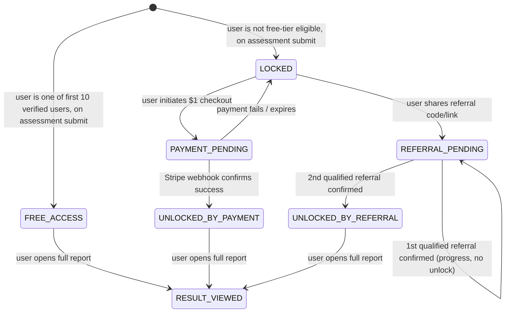
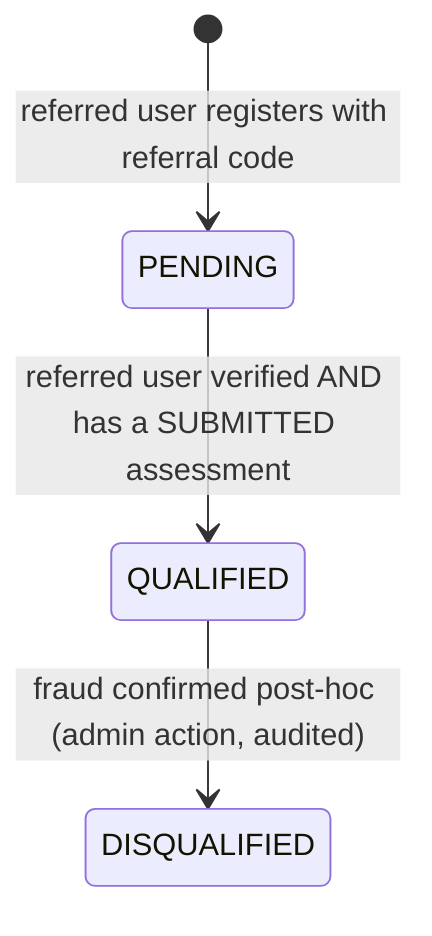

# Referral Rules & Result-Access State Machine

Status: **Implemented, Phase 7.** Authoritative source for referral
qualification and result-access logic; `docs/DATABASE.md` references this.

## 1. Result-access state machine

Notes:

- `LOCKED → REFERRAL_PENDING` is a labeling transition only (the user *can*
  pursue referrals even with zero referrals sent yet); the real gate is
  `referral_qualifications`, not this enum — this state exists so the
  locked-result screen can show "in progress" rather than a bare "locked."
  A user can be in `REFERRAL_PENDING` and still pay to unlock instantly; the
  payment path is always available regardless of referral progress.
- `RESULT_VIEWED` is set once, on first full-report view, and is terminal —
  it stops weekly reminders (§3) regardless of how the result was unlocked.
- Transitions are implemented as explicit functions in `lib/referrals` /
  `lib/payments`, each independently unit-tested with the full transition
  table as test cases (including illegal-transition rejection).

## 2. Referral qualification state machine

- A `referrals` row is created at registration time if a valid, non-self
  referral code was supplied — immutable from that point on (no re-attribution
  later, per spec).
- A `referral_qualifications` row is created alongside it in `PENDING`.
- **Implementation note — simpler than originally sketched.** The
  original design here had a `PENDING → DISQUALIFIED` automatic
  transition for "anti-abuse check fails." In practice, once the v1
  anti-abuse checks were pinned down (§4), none of them can actually
  fail *at qualification time*: self-referral and duplicate attribution
  are already prevented at `referrals` creation (DB constraint/unique
  index), and the IP heuristic deliberately only flags, never blocks
  (§4.3). So v1 has no automatic disqualification path at all —
  `DISQUALIFIED` is reached exclusively through the admin action below.
  The state exists in the schema for a future stricter check; nothing
  currently triggers it automatically.
- The qualification check (`lib/referrals/qualification.ts`,
  `checkAndQualifyReferral`) runs **synchronously inside
  `finalizeAssessment`** the moment the referred user's assessment
  transitions to `SUBMITTED` — not as an async background job as
  originally sketched (no BullMQ/worker infrastructure exists yet; see
  `docs/ARCHITECTURE.md` §4.4 for the same "synchronous now, job later"
  pattern already used for assessment auto-expiry). Transitions
  `PENDING → QUALIFIED` only if **all** of:
  1. `users.email_verified_at` is set for the referred user.
  2. The referred user has a `SUBMITTED` (not `EXPIRED`) assessment.
  3. (Recorded, not gating) whether referrer and referred share a
     registration IP — sets `flaggedSuspicious` for admin review (§4.3).
- `QUALIFIED → DISQUALIFIED` is an admin-only, audited action
  (`lib/referrals/admin.ts`, `disqualifyReferral` — writes `audit_logs`
  with action `REFERRAL_DISQUALIFIED`), used for retroactive fraud
  findings. Per spec ("existing qualified referrals must never be
  lost"), this path exists for genuine fraud only, not as a general
  reversal mechanism, and disqualifying a referral that had already
  contributed to an unlock does **not** revoke that unlock — it only
  prevents the referral from counting toward *future* thresholds.

## 3. Unlock-threshold logic — implemented

- A user's result unlocks via referral the moment their count of
  `QUALIFIED` referrals (where they are `referrer_user_id`) reaches the
  threshold, checked from two call sites (`lib/referrals/unlock.ts`,
  `tryUnlockViaReferral`): right after a referral qualifies
  (`lib/referrals/qualification.ts`), and at `AssessmentResult` creation
  time (`lib/results/create-result.ts`) in case the referrer already had
  enough qualified referrals *before* ever taking their own assessment —
  that path sets `resultAccessState = UNLOCKED_BY_REFERRAL` directly at
  creation rather than briefly writing `LOCKED` first.
- Idempotency is enforced by the DB's unique constraint on
  `result_unlocks.assessment_result_id`, not by an explicit row lock — a
  duplicate concurrent call simply loses the unique-constraint race and
  no-ops (caught and swallowed, not an error). Simpler than a `SELECT ...
  FOR UPDATE` and equally correct for this specific invariant.
- If a user has retaken the assessment (Phase 5 allows unrestricted
  retakes — not a scenario this design originally considered), the
  unlock applies to their most recently created result that's still in a
  locked-family state, not every past attempt.
- The threshold (`2` by default) is the `referral_qualification_threshold`
  system_settings value, not a hardcoded constant, per the
  admin-configurable requirement in Part 9 (`lib/referrals/progress.ts`,
  `getReferralThreshold`).

## 4. Anti-abuse checks (v1 — extend as fraud patterns emerge)

Minimum viable checks before a referral qualifies:

1. **No self-referral** — enforced at the DB level
   (`referrer_user_id <> referred_user_id` check constraint) and rejected at
   registration time if the referral code resolves to the registering user's
   own email/session.
2. **No duplicate referred-user attribution** — `referrals.referred_user_id`
   unique; a user can only ever be *someone's* referral once, first write
   wins.
3. **Same-registration-IP heuristic — implemented** (device fingerprinting
   is not; flagged as a future enhancement). `users.registration_ip` is
   captured once, at registration, and never updated. At qualification
   time, if the referrer's and referred user's `registration_ip` match,
   `referral_qualifications.flagged_suspicious` is set `true` —
   qualification still proceeds (flag, not block). Flagged referrals
   surface in the admin referral dashboard with "flagged (same
   registration IP)" for manual disqualification, to avoid false
   positives (e.g., two real friends on the same home Wi-Fi) auto-
   rejecting a legitimate free-unlock path.
4. **Real completion required** — registration alone never counts (explicit
   spec requirement); the assessment must reach `SUBMITTED`.
5. **Rate limit on referral code generation/registration attempts** — via
   `lib/rate-limit`, to blunt scripted mass-registration abuse.

Anti-abuse is deliberately conservative in v1 (flag + admin review over
auto-block) because false positives directly block a legitimate free-unlock
path, which is a core growth mechanic.

## 5. Why referral progress tracking is separate from qualification

The locked-result screen (Part 6) must show referral progress ("1 of 2
friends qualified") without exposing qualification internals. This is served
by a read-only projection: `count(referral_qualifications where status =
QUALIFIED and referral.referrer_user_id = :user)`, computed on read, not
stored redundantly — avoids a second source of truth that could drift from
the qualifications table.
